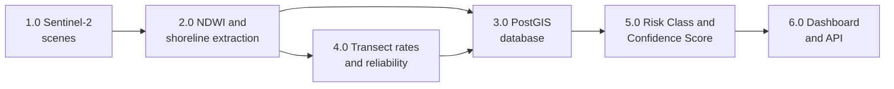
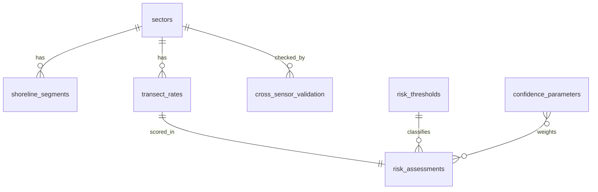

<div align="center">

# 🌊 Shoreline Analytics

### Satellite-based coastal erosion and risk mapping for Alexandria, Egypt

PostGIS database · Sentinel-2 shorelines 2018–2026 · Risk Class and Confidence Score per transect


**[📖 Open the documentation site](https://hegererefe111-debug.github.io/shoreline-docs/)**

</div>

---

> **Status: provisional.** Independent validation of the shorelines is still pending, so every rate and class below is an *apparent trend*, not a surveyed fact. See [Limitations](#limitations).

## At a glance

| | |
|:--|:--|
| **205** | shoreline segments from 9 years of Sentinel-2 scenes |
| **3** | sectors: Corniche Infill, Eastern Harbour, Montaza Bay |
| **145** | transects with a rate in metres per year |
| **4** | transects with accretion that survives the multiple-testing correction (all in Montaza Bay) |
| **13** | transects in the HIGH or VERY_HIGH class, **2** of them with MEDIUM confidence or better |

## How the data flows



## Database design

PostgreSQL 17 with PostGIS 3.5, schema `shoreline`, every geometry in **EPSG:32636** (WGS 84 / UTM zone 36N).



| Table | Rows | Holds |
|---|--:|---|
| `sectors` | 3 | The three study zones |
| `shoreline_segments` | 205 | One shoreline line per sector, year and segment |
| `transect_rates` | 145 | Rate (m/yr), R², p-values, reliability class |
| `cross_sensor_validation` | 3 | Sentinel-2 against Landsat 9 for 2026, per sector |
| `risk_thresholds` | 5 | The five risk classes and their limits |
| `confidence_parameters` | 14 | Weights and settings of the Confidence Score |
| `risk_assessments` | 145 | One Risk Class and one Confidence Score per transect |

Views: `v_sector_year_summary` · `v_risk_calc` · `v_transect_risk` · `v_sector_risk`  
Function: `shoreline.assess_risk()` recalculates every risk and confidence value.

## Quick start

**1. Install the Python packages**

```bash
pip install -r database/requirements.txt
```

**2. Put the data in place.** The scripts read a folder (default `D:\shoreline_project\data\Alexandria_Shoreline_v2`, or pass another path as the first argument):

<details>
<summary>The six files the folder needs</summary>

```
sectors.gpkg
shorelines_by_sector_ANALYSIS_2018_2026_v2.gpkg
transect_statistical_reliability.csv
erosion_rate_sensitivity_test.csv
Significant_Transect_Spatial_Verification.csv
Independent_Cross_Sensor_Validation_2026.csv
```

The raw data is not stored in this repository.
</details>

**3. Run in this order** (SQL in pgAdmin's Query Tool or `psql -f`):

| # | Step | Expected result |
|:-:|---|---|
| 1 | `database/sql/01_create_tables.sql` | drops and re-creates the tables |
| 2 | `python database/scripts/load_shorelines.py` | 3 sectors, 205 segments |
| 3 | `database/sql/02_views.sql` | views created |
| 4 | `database/sql/03_analysis_tables.sql` | analysis tables created |
| 5 | `database/sql/04_risk_confidence.sql` | risk views and `assess_risk()` created |
| 6 | `python database/scripts/load_transects.py` | 145 transects, 145 risk assessments |

Both scripts ask for the database password and never store it. Each loads inside one transaction and checks the row counts before committing, so a wrong file saves nothing.

**4. Check it**

```sql
SELECT * FROM shoreline.v_sector_risk;
```

## Risk and confidence

The two are kept apart on purpose: a transect can show strong erosion with low confidence.

### Risk Class: how much the shoreline moves and in which direction

| Class | Rate (m per year) |
|---|---|
| 🟢 `VERY_LOW` | above +2 (accretion) |
| 🟢 `LOW` | +1 to +2 |
| 🟡 `MODERATE` | −1 to +1 |
| 🟠 `HIGH` | −2 to −1 |
| 🔴 `VERY_HIGH` | below −2 (erosion) |

### Confidence Score (0 to 1): how strong the evidence is

| Part | Weight |
|---|--:|
| Statistical evidence (adjusted p-value) | 0.30 |
| Fit of the line (R²) | 0.15 |
| Years observed, out of nine | 0.15 |
| Stability of the rate without the 2024 scene | 0.15 |
| Shoreline line quality of the sector | 0.10 |
| Landsat 9 agreement of the sector | 0.15 |

Bands: **HIGH** from 0.80 (only for a significant trend), **MEDIUM** from 0.60, otherwise **LOW**.

The weights and limits are this project's proposal. They live in `confidence_parameters` and `risk_thresholds`, so changing one is an `UPDATE` followed by:

```sql
SELECT shoreline.assess_risk();
```

## Results

| Sector | Transects | Median rate (m/yr) | Erosion | Accretion | Significant |
|---|--:|--:|--:|--:|--:|
| Corniche Infill | 42 | +0.23 | 13 | 27 | 0 |
| Eastern Harbour | 26 | +0.21 | 10 | 15 | 0 |
| Montaza Bay | 77 | +0.93 | 14 | 62 | 4 |

- The median transect moves slightly **seaward** in every sector.
- The four significant Montaza transects are local accretion hotspots, not a trend of the whole bay.
- None of the HIGH or VERY_HIGH transects has a HIGH confidence score: they are places to check, not findings.

## Limitations

- All shorelines and rates are **provisional**; independent validation is pending.
- The shoreline is a water-mask proxy at 10 m resolution, not a surveyed line.
- The satellite sees the waterline, not the cause. Reclamation, breakwaters, piers and other works can look like erosion or accretion, so a few extreme transects are under review.
- Landsat 9 was compared for 2026 only.
- Most transects fit a straight line poorly (median R² 0.13); only 4 of 145 pass the corrected significance test.
- The 2024 scene is an alternative acquisition; its effect is tested in `rate_excl_2024`.
- The Confidence Score weights are a proposal and can be changed.

## Repository layout

```
.
├── index.html · overview.html · er.html · dfd.html
│   activity.html · logical.html · physical.html · team.html     documentation site (GitHub Pages)
└── database/
    ├── sql/        01_create_tables.sql  02_views.sql  03_analysis_tables.sql  04_risk_confidence.sql
    ├── scripts/    load_shorelines.py    load_transects.py
    └── requirements.txt
```

## Team

| Member | Role |
|---|---|
| Asmaa Bahaa | Data ingestion |
| Doha Yehia | Shoreline extraction, transect rates and reliability |
| **Hagar Arafa** | **PostGIS database, risk class and confidence score** |
| Nourhan Fathy | Dashboard |
| Shahd Abdelnasser | API and deployment |

## Data sources

Sentinel-2 L2A imagery from Microsoft Planetary Computer. Landsat 9 Collection 2 Level-2 for the 2026 cross-check.

<div align="center">

*DEPI graduation project · Alexandria · 2026*

</div>
